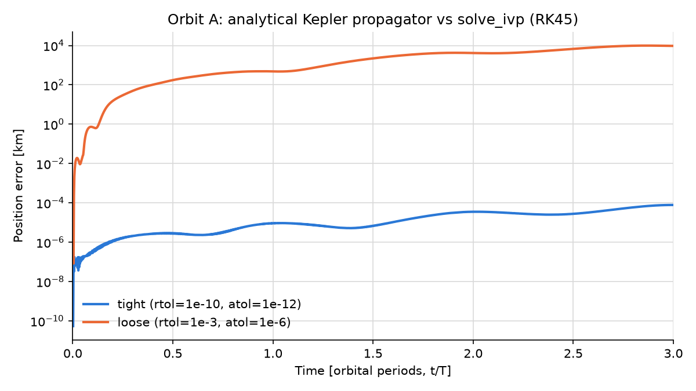

# kepler-propagator

Analytical two-body propagator for elliptical orbits, built on a Newton solver for
Kepler's equation and Lagrange f and g coefficients, and validated against numerical
integration with `scipy.integrate.solve_ivp`. Project 2 of a flight-dynamics portfolio
(Project 1: orbital-mechanics-python, numerical two-body propagation).

## Method

- **Kepler's equation** `E - e sin E = M` is solved with Newton-Raphson
  (`E_{k+1} = E_k - (E_k - e sin E_k - M) / (1 - e cos E_k)`), with `M` reduced to
  `[0, 2pi)` and default initial guess `E0 = pi`. Anomaly conversions use `arctan2`
  on half angles, so `E = pi` is not singular.
- **Propagation** uses the Lagrange coefficients written in the eccentric-anomaly
  increment `dE` (equivalent to universal variables with `chi = sqrt(a) dE`):

  ```
  f  = 1 - (a/r0)(1 - cos dE)          g  = dt - (dE - sin dE)/n
  fd = -sqrt(mu a) sin dE / (r r0)     gd = 1 - (a/r)(1 - cos dE)
  ```

  `dE` is unwrapped (`dE = E + 2pi floor(M/2pi) - E0`) so that negative and
  multi-revolution `dt` give the correct `g`.
- The textbook form in the true-anomaly increment `dtheta` (Curtis) is implemented
  only as a cross-check: its `fd` divides by `sin(dtheta)`, so it is singular at
  `dtheta = k pi` (e.g. `dt = T`, or half a period from perigee). The `dE` form has no
  such singularity and also works for near-circular orbits.

## Installation and usage

```bash
python -m venv .venv
source .venv/Scripts/activate      # Windows Git Bash; on Linux/macOS: source .venv/bin/activate
pip install -r requirements.txt
pip install -e .

pytest -v
python scripts/compare_numerical.py   # writes figures/position_error.png
python scripts/newton_iterations.py   # Newton iterations with E0 = M vs E0 = pi
```

```python
from orbits.kepler import propagate_kepler

r, v = propagate_kepler([-6045, -3490, 2500], [-3.457, 6.618, 2.533], dt=3600.0)  # km, km/s, s
```

Units are km, s and km/s throughout; angles are radians inside the code.

## Analytical vs numerical



Orbit A over three periods, against `solve_ivp` (RK45):

| Tolerances | Max error | Final error |
|---|---|---|
| `rtol=1e-10, atol=1e-12` | 7.8e-5 km | 7.8e-5 km |
| `rtol=1e-3, atol=1e-6` | 9.9e3 km | 9.6e3 km |

The analytical solution is exact up to round-off and has no integration tolerance,
so the curves are the integrator's own error. With tight tolerances it stays at the
centimetre level; with loose tolerances the energy drifts by about 10 % and the
satellite runs thousands of km ahead of its true position. This makes the analytical
propagator a reference for validating numerical integrators.

## Validation

`pytest -v` runs 47 tests:

- **Kepler solver** (`tests/test_kepler_solver.py`): five `(M, e)` cases checked on `E`,
  `theta` and the residual `|E - e sin E - M| < 1e-12`; `theta <-> E` round trip
  (including `E = 0, pi`); reduction of negative and multi-revolution `M`; errors for
  `e >= 1` and non-convergence; anomalies and timing of orbit A.
- **Propagator** (`tests/test_propagator.py`): reference states for orbit A
  (`r0 = [-6045, -3490, 2500] km`, `v0 = [-3.457, 6.618, 2.533] km/s`) at
  `dt = 0, 1800, 3600, T, -3600, 3T+1000 s` and for orbit B (`r_p = 7000 km`, `e = 0.7`)
  at `dt = 1000, T/2, 5000 s`; apogee physics (`r.v = 0`, `v_a = v_p r_p / r_a`);
  `f gd - fd g = 1`; forward/backward round trip; conservation of energy and `|h|`
  to 1e-12; agreement of the `dE` and `dtheta` forms; singularity of the `dtheta`
  form; rejection of hyperbolic orbits; agreement with `solve_ivp` to < 1 m at 1 h.
- **Smoke** (`tests/test_smoke.py`): imports and `a`, `e` of orbit A.

Reference values are tabulated in the test files to 3 decimals (km) and 5 decimals
(rad, km/s); tolerances match the number of quoted digits and are never widened to
make a test pass.

## Known limitations

- Elliptical orbits only: no parabolic or hyperbolic trajectories (the natural
  extension is the universal-variable formulation).
- Pure two-body problem: no perturbations (J2, drag, third body), which are the
  subject of Project 3.

## References

- H. D. Curtis, *Orbital Mechanics for Engineering Students*, ch. 3.
- G. Mengali, *Space Flight Mechanics*, Università di Pisa (lecture notes), ch. 3-4.
